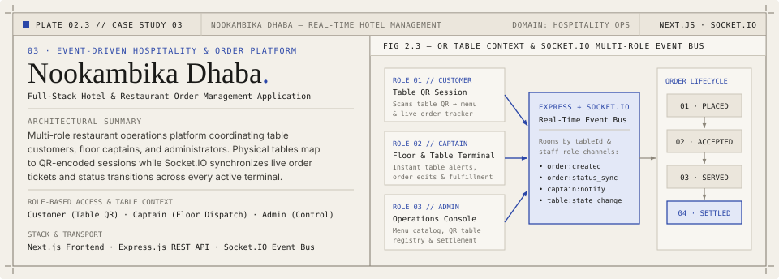
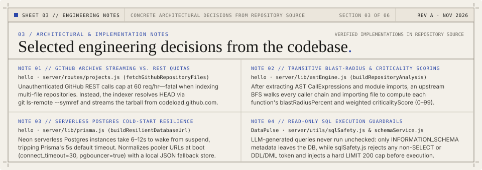
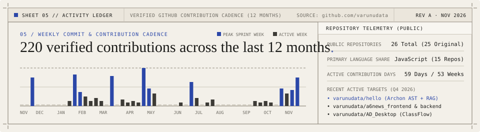

<picture>
  <source media="(prefers-color-scheme: dark)" srcset="./assets/sheet-00-cover-dark.svg">
  <source media="(prefers-color-scheme: light)" srcset="./assets/sheet-00-cover-light.svg">
  
</picture>

[**01. ABOUT**](#about) &nbsp;&middot;&nbsp; [**02. SELECTED WORK**](#selected-work) &nbsp;&middot;&nbsp; [**03. ENGINEERING**](#engineering) &nbsp;&middot;&nbsp; [**04. TECHNOLOGIES**](#technologies) &nbsp;&middot;&nbsp; [**05. ACTIVITY**](#activity) &nbsp;&middot;&nbsp; [**06. CONTACT**](#contact)

<picture>
  <source media="(prefers-color-scheme: dark)" srcset="./assets/sheet-01-about-dark.svg">
  <source media="(prefers-color-scheme: light)" srcset="./assets/sheet-01-about-light.svg">
  
</picture>

I am a third-year Computer Science and Engineering (`AI/ML`) undergraduate at **Rishihood University**, preparing for software engineering internships and placements. My primary craft is **full-stack web development in JavaScript**—designing and building applications where the relational data model, backend API boundaries, real-time transport, and frontend interface are engineered as a single coherent system. While my academic curriculum includes machine learning and AI, my strongest work centers on **full-stack product engineering, backend and database architecture, DevOps fundamentals, and deterministic developer/data tooling**.

<picture>
  <source media="(prefers-color-scheme: dark)" srcset="./assets/sheet-02-header-dark.svg">
  <source media="(prefers-color-scheme: light)" srcset="./assets/sheet-02-header-light.svg">
  
</picture>

<picture>
  <source media="(prefers-color-scheme: dark)" srcset="./assets/work-01-hello-dark.svg">
  <source media="(prefers-color-scheme: light)" srcset="./assets/work-01-hello-light.svg">
  
</picture>

| Specification | Case Study 01 &mdash; Codebase Intelligence Platform (`hello` &middot; Main Project) |
| :--- | :--- |
| **Problem** | Navigating large codebases requires mentally reconstructing cross-file call chains and import graphs, while standard RAG pipelines chunk source files blindly without structural awareness of caller/callee relationships or change impact. |
| **Implementation** | Streams repository tarballs via `codeload.github.com` and `git ls-remote --symref` (bypassing GitHub's 60 req/hr REST limit); parses JS/TS into ASTs via `@babel/parser` &amp; `@babel/traverse` alongside polyglot syntax parsers; computes upstream BFS **blast radius (%)** and **criticality scores (`0–99`)**; answers codebase questions via a **4-stage Graph-Aware RAG** (Report Guard &rarr; Stem/AST Call-Graph Matcher with `/api/...` route bridging &rarr; 20B SLM Router Fallback &rarr; 120B LLM Scoped Synthesis). |
| **Stack** | `JavaScript` &middot; `Next.js 16` &middot; `React 19` &middot; `Tailwind CSS v4` &middot; `Node.js` &middot; `Express 5` &middot; `Prisma ORM v6` &middot; `Neon PostgreSQL` &middot; `@babel/parser` &middot; `@babel/traverse` |
| **Inspection** | [**Repository (`varunudata/hello`)**](https://github.com/varunudata/hello) &nbsp;&middot;&nbsp; [**AST Engine (`astEngine.js`)**](https://github.com/varunudata/hello/blob/main/server/lib/astEngine.js) &nbsp;&middot;&nbsp; [**4-Stage Graph RAG (`codebaseRag.js`)**](https://github.com/varunudata/hello/blob/main/server/lib/codebaseRag.js) &nbsp;&middot;&nbsp; [**Report Synthesizer (`projectReports.js`)**](https://github.com/varunudata/hello/blob/main/server/lib/projectReports.js) |

<picture>
  <source media="(prefers-color-scheme: dark)" srcset="./assets/work-02-datapulse-dark.svg">
  <source media="(prefers-color-scheme: light)" srcset="./assets/work-02-datapulse-light.svg">
  
</picture>

| Specification | Case Study 02 &mdash; DataPulse: Natural-Language SQL &amp; Database Analytics |
| :--- | :--- |
| **Problem** | Extracting insights from relational databases requires manual SQL authoring, while naively connecting LLMs to production databases risks leaking private row data or executing destructive `DROP`/`DELETE`/`UPDATE` queries. |
| **Implementation** | Connects to external MySQL databases via `mysql2/promise` pools and queries only `INFORMATION_SCHEMA.tables` and `columns` (exposing zero row values to the LLM); synthesizes SQL via Google Gemini; validates queries through `sqlSafety.js` (`isSafeSelectQuery` enforcing `SELECT`-only + `ensureLimit(200)`); renders interactive **Recharts** visualizations and persists pinned live charts in PostgreSQL via Prisma ORM. |
| **Stack** | `Next.js 15` &middot; `React 19` &middot; `Tailwind CSS v4` &middot; `Radix UI` &middot; `Recharts` &middot; `Node.js` &middot; `Express.js` &middot; `Prisma ORM` &middot; `PostgreSQL` &middot; `MySQL (mysql2)` &middot; `Gemini API` &middot; `JWT & Bcrypt` |
| **Inspection** | [**Repository (`varunudata/DataPulse`)**](https://github.com/varunudata/DataPulse) &nbsp;&middot;&nbsp; [**SQL Safety Gate (`sqlSafety.js`)**](https://github.com/varunudata/DataPulse/blob/main/server/utils/sqlSafety.js) &nbsp;&middot;&nbsp; [**Schema Introspection (`schemaService.js`)**](https://github.com/varunudata/DataPulse/blob/main/server/services/schemaService.js) |

<picture>
  <source media="(prefers-color-scheme: dark)" srcset="./assets/work-03-nookambika-dark.svg">
  <source media="(prefers-color-scheme: light)" srcset="./assets/work-03-nookambika-light.svg">
  
</picture>

| Specification | Case Study 03 &mdash; Nookambika Dhaba: Real-Time Hotel Management System |
| :--- | :--- |
| **Problem** | High-turnover restaurant floors suffer from ticket latency and state drift between diners ordering at tables, floor captains managing sections, and administrators overseeing kitchen dispatch and billing. |
| **Implementation** | Separates operational workflows across role-guarded **Customer**, **Captain**, and **Admin** interfaces; binds physical restaurant tables to unique QR codes that initialize table-scoped ordering sessions; coordinates live order creation, item modifications, captain notifications, and state transitions (`PLACED` &rarr; `ACCEPTED` &rarr; `SERVED` &rarr; `SETTLED`) over an Express + **Socket.IO** real-time event bus paired with a Next.js frontend. |
| **Stack** | `JavaScript` &middot; `Next.js` &middot; `React.js` &middot; `Tailwind CSS` &middot; `Node.js` &middot; `Express.js` &middot; `Socket.IO` &middot; `REST APIs` &middot; `Role-Based Authentication` |

<picture>
  <source media="(prefers-color-scheme: dark)" srcset="./assets/work-04-a6news-dark.svg">
  <source media="(prefers-color-scheme: light)" srcset="./assets/work-04-a6news-light.svg">
  
</picture>

| Specification | Case Study 04 &mdash; A6News Infra: Production News Portal, CMS &amp; CI/CD |
| :--- | :--- |
| **Problem** | Delivering fast, server-rendered infrastructure news to public readers while providing editors with a secure administrative CMS for draft/publish workflows, breaking tickers, and multipart media galleries. |
| **Implementation** | Pairs a Next.js 15 App Router frontend (`a6news_frontend`) with an Express + Prisma + PostgreSQL backend (`a6news_backend`) modeling `User`, `Category`, `Ticker`, and slug-indexed `Post` records (`DRAFT` / `PUBLISHED`) with `Multer` media handling. Automated GitHub Actions CI/CD joins a **Tailscale** mesh VPN, SSHes into AWS EC2, diffs `package-lock.json` to skip redundant `npm ci` runs, runs `prisma generate`, and reloads `pm2`. |
| **Stack** | `JavaScript` &middot; `Next.js 15` &middot; `React 19` &middot; `Tailwind CSS v4` &middot; `Node.js` &middot; `Express.js` &middot; `Prisma ORM` &middot; `PostgreSQL` &middot; `Multer` &middot; `JWT & Bcrypt` &middot; `GitHub Actions` &middot; `Tailscale` &middot; `AWS EC2 & PM2` |
| **Inspection** | [**Live Production (`a6newsinfra.com`)**](https://a6newsinfra.com) &nbsp;&middot;&nbsp; [**Frontend Repo (`a6news_frontend`)**](https://github.com/varunudata/a6news_frontend) &nbsp;&middot;&nbsp; [**Backend Repo (`a6news_backend`)**](https://github.com/varunudata/a6news_backend) &nbsp;&middot;&nbsp; [**Tailscale EC2 Workflow (`deploy.yml`)**](https://github.com/varunudata/a6news_backend/blob/main/.github/workflows/deploy.yml) |

| Index | Additional Verified Public Repositories | Architecture &amp; Technology Stack | Links |
| :--- | :--- | :--- | :--- |
| **05** | **Pixify** &mdash; _AI Image Synthesis &amp; Credit Ledger_ | Credit-metered text-to-image platform integrating ClipDrop synthesis, JWT/bcrypt auth, and **Razorpay** payment order verification. (`React 19` &middot; `Tailwind v4` &middot; `Express` &middot; `MongoDB` &middot; `Razorpay`) | [**Repo**](https://github.com/varunudata/pixify) &middot; [**Live**](https://pixify-blue.vercel.app) |
| **06** | **ClassFlow (`AD_Desktop`)** &mdash; _Timetable &amp; Conflict Engine_ | Electron desktop scheduler with a context-isolated IPC bridge and an **interval-overlap &amp; room-capacity conflict detector**. (`Electron` &middot; `React 18` &middot; `TypeScript` &middot; `Prisma` &middot; `PostgreSQL`) | [**Repo**](https://github.com/varunudata/AD_Desktop) |
| **07** | **LearnFlow** &mdash; _Role-Based Learning Management System_ | Full-stack LMS supporting faculty course/module authoring, enrollment moderation, assignment submissions, and grading. (`Next.js` &middot; `React` &middot; `Express` &middot; `Prisma` &middot; `PostgreSQL`) | [**Repo**](https://github.com/varunudata/LearnFlow) |
| **08** | **Private LAN Service Edge (`CN_Project`)** &mdash; _DNS &amp; TLS Proxy_ | Local network topology pairing `dnsmasq` private domain resolution with an `nginx` TLS 1.2/1.3 reverse proxy and round-robin failover. (`Nginx` &middot; `dnsmasq` &middot; `TLS CA` &middot; `Express`) | [**Repo**](https://github.com/varunudata/CN_Project) |
| **09** | **Water Quality ML Benchmark (`AML_Capstone`)** | Leakage-safe ML benchmark across 2.82M environmental records enforcing site-held-out `GroupShuffleSplit` and two-stage ceiling censoring. (`Python` &middot; `XGBoost` &middot; `Scikit-Learn` &middot; `Pytest`) | [**Repo**](https://github.com/varunudata/AML_Capstone) |

<picture>
  <source media="(prefers-color-scheme: dark)" srcset="./assets/sheet-03-engineering-dark.svg">
  <source media="(prefers-color-scheme: light)" srcset="./assets/sheet-03-engineering-light.svg">
  
</picture>

| Note | Architectural Mechanism | Direct Source Permalink |
| :--- | :--- | :--- |
| **01** | Quota-immune GitHub tarball stream ingestion &amp; `git ls-remote --symref` branch detection | [`hello/server/routes/projects.js#L584-L660`](https://github.com/varunudata/hello/blob/d66dfb27992cf50a45bc7328b4d9d3c7ad28e76d/server/routes/projects.js#L584-L660) |
| **02** | Upstream BFS call-graph traversal for transitive `blastRadiusPercent` &amp; `criticalityScore` | [`hello/server/lib/astEngine.js#L726-L819`](https://github.com/varunudata/hello/blob/d66dfb27992cf50a45bc7328b4d9d3c7ad28e76d/server/lib/astEngine.js#L726-L819) |
| **03** | Serverless Neon PostgreSQL cold-start timeout normalization &amp; local JSON fallback mirror | [`hello/server/lib/prisma.js#L21-L59`](https://github.com/varunudata/hello/blob/d66dfb27992cf50a45bc7328b4d9d3c7ad28e76d/server/lib/prisma.js#L21-L59) |
| **04** | Deterministic read-only `SELECT` verification, DDL/DML rejection &amp; `LIMIT 200` query bounding | [`DataPulse/server/utils/sqlSafety.js#L1-L15`](https://github.com/varunudata/DataPulse/blob/289656d06a0a375fe47c692a63ad84fabf18eaae/server/utils/sqlSafety.js#L1-L15) |

<picture>
  <source media="(prefers-color-scheme: dark)" srcset="./assets/sheet-04-technologies-dark.svg">
  <source media="(prefers-color-scheme: light)" srcset="./assets/sheet-04-technologies-light.svg">
  
</picture>

<picture>
  <source media="(prefers-color-scheme: dark)" srcset="./assets/sheet-05-activity-dark.svg">
  <source media="(prefers-color-scheme: light)" srcset="./assets/sheet-05-activity-light.svg">
  
</picture>

<picture>
  <source media="(prefers-color-scheme: dark)" srcset="./assets/sheet-06-contact-dark.svg">
  <source media="(prefers-color-scheme: light)" srcset="./assets/sheet-06-contact-light.svg">
  
</picture>

[**EMAIL &mdash; `varunudata@gmail.com`**](mailto:varunudata@gmail.com) &nbsp;&middot;&nbsp; [**LINKEDIN &mdash; `in/varunudata`**](https://www.linkedin.com/in/varunudata) &nbsp;&middot;&nbsp; [**GITHUB &mdash; `github.com/varunudata`**](https://github.com/varunudata) &nbsp;&middot;&nbsp; [**X &mdash; `@udatavarun`**](https://x.com/udatavarun)

**DRAWING SET VU-2026** &middot; TYPESET IN INSTRUMENT SERIF, IBM PLEX SANS &amp; IBM PLEX MONO &middot; BUILT DETERMINISTICALLY VIA `design/build_assets.py`

