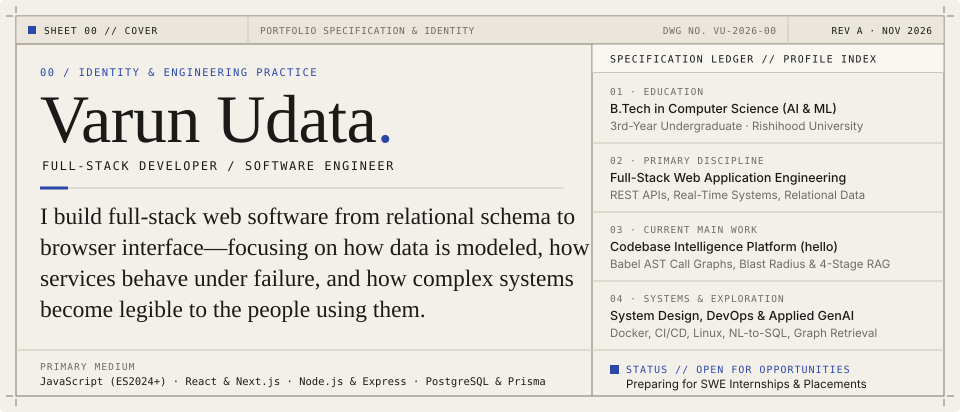
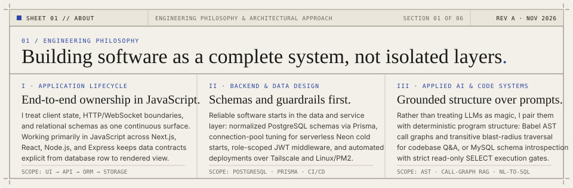
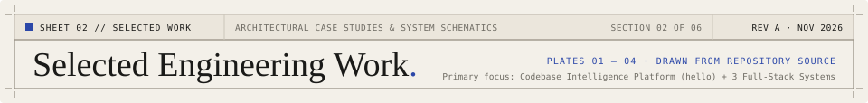
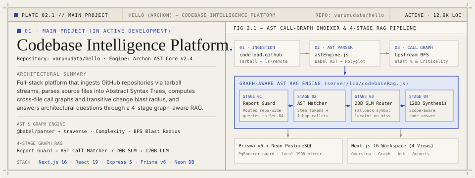
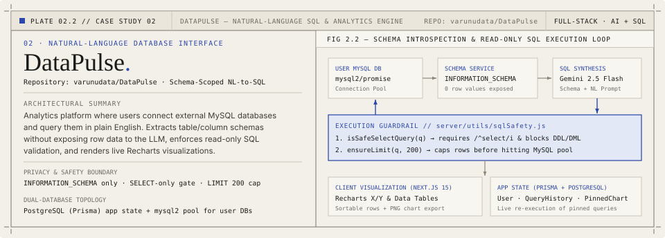
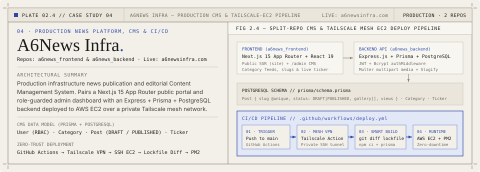
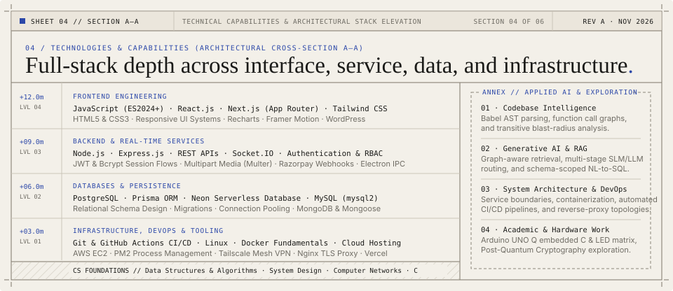
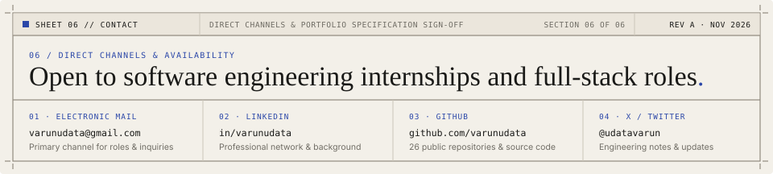

<picture>
  <source media="(prefers-color-scheme: dark)" srcset="./assets/sheet-00-cover-dark.svg">
  <source media="(prefers-color-scheme: light)" srcset="./assets/sheet-00-cover-light.svg">
  
</picture>

[**01. ABOUT**](#01-about) &nbsp;&middot;&nbsp; [**02. SELECTED WORK**](#02-selected-work) &nbsp;&middot;&nbsp; [**03. ENGINEERING**](#03-engineering) &nbsp;&middot;&nbsp; [**04. TECHNOLOGIES**](#04-technologies) &nbsp;&middot;&nbsp; [**05. ACTIVITY**](#05-activity) &nbsp;&middot;&nbsp; [**06. CONTACT**](#06-contact)

---

### 01. About

<picture>
  <source media="(prefers-color-scheme: dark)" srcset="./assets/sheet-01-about-dark.svg">
  <source media="(prefers-color-scheme: light)" srcset="./assets/sheet-01-about-light.svg">
  
</picture>

I am a third-year Computer Science and Engineering (`AI/ML`) undergraduate at **Rishihood University**, preparing for software engineering internships and placements. My primary craft is **full-stack web development in JavaScript**—designing and building applications where the relational data model, backend API boundaries, real-time transport, and frontend interface are engineered as a single coherent system.

While my academic coursework covers machine learning and artificial intelligence, my strongest engineering work sits at the intersection of **full-stack application architecture, database design, DevOps fundamentals, and practical developer/data tooling**—using deterministic mechanisms like Abstract Syntax Tree (AST) analysis and database schema introspection to ground generative AI workflows.

---

### 02. Selected Work

<picture>
  <source media="(prefers-color-scheme: dark)" srcset="./assets/sheet-02-header-dark.svg">
  <source media="(prefers-color-scheme: light)" srcset="./assets/sheet-02-header-light.svg">
  
</picture>

#### 01 / Codebase Intelligence Platform (`hello` — Main Project)

<picture>
  <source media="(prefers-color-scheme: dark)" srcset="./assets/work-01-hello-dark.svg">
  <source media="(prefers-color-scheme: light)" srcset="./assets/work-01-hello-light.svg">
  
</picture>

An engineering platform built to help developers navigate, audit, and query large repositories through static program analysis and graph-grounded retrieval.

* **Problem Addressed:** Navigating unfamiliar repositories requires mentally reconstructing cross-file function call chains and import graphs, while standard RAG pipelines chunk source files blindly without understanding caller/callee relationships or change blast radius.
* **Technical Implementation:**
  * **Quota-Immune Repository Ingestion:** Streams repository archives directly from `codeload.github.com` and resolves default branches via `git ls-remote --symref`, bypassing GitHub's 60 req/hr unauthenticated REST rate limit.
  * **AST & Call-Graph Engine (`server/lib/astEngine.js`):** Parses JavaScript/TypeScript via `@babel/parser` and `@babel/traverse` (alongside syntax analyzers for Python, Go, Rust, and Java) to extract function signatures, parameter patterns, JSX invocations, Express route handlers, cyclomatic complexity, and cross-file dependency edges.
  * **Transitive Blast-Radius & Criticality Scoring:** Executes upstream breadth-first search (BFS) across function callers and module importers to calculate the exact percentage of files impacted if a function changes (`blastRadiusPercent`) and assigns a weighted `criticalityScore` (`0–99`).
  * **4-Stage Graph-Aware AST RAG (`server/lib/codebaseRag.js`):** Routes user questions through (1) a whole-repository report guard, (2) stem-normalized keyword matching over the AST call graph with 1-hop caller/callee expansion and frontend-to-backend `/api/...` route bridging, (3) a fast 20B Small Language Model fallback router when lexical matching misses, and (4) a 120B LLM synthesis pass scoped strictly to matched symbols.
* **Technology Stack:** `JavaScript` &middot; `Next.js 16` &middot; `React 19` &middot; `Tailwind CSS v4` &middot; `Node.js` &middot; `Express 5` &middot; `Prisma ORM v6` &middot; `Neon PostgreSQL` &middot; `@babel/parser` &middot; `@babel/traverse`
* **Links:** [**Repository (`varunudata/hello`)**](https://github.com/varunudata/hello) &nbsp;&middot;&nbsp; [**AST Engine Source**](https://github.com/varunudata/hello/blob/main/server/lib/astEngine.js) &nbsp;&middot;&nbsp; [**4-Stage Graph RAG Source**](https://github.com/varunudata/hello/blob/main/server/lib/codebaseRag.js) &nbsp;&middot;&nbsp; [**Project Reports Synthesizer**](https://github.com/varunudata/hello/blob/main/server/lib/projectReports.js)

---

#### 02 / DataPulse — Natural-Language SQL & Database Analytics Platform

<picture>
  <source media="(prefers-color-scheme: dark)" srcset="./assets/work-02-datapulse-dark.svg">
  <source media="(prefers-color-scheme: light)" srcset="./assets/work-02-datapulse-light.svg">
  
</picture>

A full-stack analytics application where users connect external MySQL databases and query them in natural language, receiving validated SQL execution results and interactive visualizations.

* **Problem Addressed:** Extracting ad-hoc insights from relational databases requires manual SQL authoring, while naively connecting LLMs to production databases risks leaking sensitive row records or executing destructive `DROP`/`DELETE`/`UPDATE` statements.
* **Technical Implementation:**
  * **Zero-Row Schema Introspection (`server/services/schemaService.js`):** Connects to user databases via `mysql2/promise` connection pools and queries only `INFORMATION_SCHEMA.tables` and `INFORMATION_SCHEMA.columns` so table relationships and column types provide context to the model without exposing underlying row data.
  * **Read-Only SQL Safety Gate (`server/utils/sqlSafety.js`):** Validates every Gemini-generated statement through `isSafeSelectQuery()`—requiring a leading `SELECT`, rejecting DDL/DML verbs (`INSERT`, `UPDATE`, `DELETE`, `DROP`, `ALTER`, `TRUNCATE`, `CALL`), and enforcing a hard row cap via `ensureLimit(query, 200)` prior to execution.
  * **Dual-Database Persistence & Live Dashboards:** Uses PostgreSQL and Prisma ORM (`User`, `QueryHistory`, `PinnedChart`) to persist user sessions, prompt history, and pinned Recharts configurations (`chartType`, `xAxis`, `yAxis`, `query`) that re-execute live against the connected MySQL source.
* **Technology Stack:** `Next.js 15` &middot; `React 19` &middot; `Tailwind CSS v4` &middot; `Radix UI` &middot; `Recharts` &middot; `Node.js` &middot; `Express.js` &middot; `Prisma ORM` &middot; `PostgreSQL` &middot; `MySQL (mysql2)` &middot; `Google Gemini API` &middot; `JWT & Bcrypt`
* **Links:** [**Repository (`varunudata/DataPulse`)**](https://github.com/varunudata/DataPulse) &nbsp;&middot;&nbsp; [**SQL Safety Guardrail**](https://github.com/varunudata/DataPulse/blob/main/server/utils/sqlSafety.js) &nbsp;&middot;&nbsp; [**Schema Introspection Service**](https://github.com/varunudata/DataPulse/blob/main/server/services/schemaService.js)

---

#### 03 / Nookambika Dhaba — Real-Time Hotel & Order Management System

<picture>
  <source media="(prefers-color-scheme: dark)" srcset="./assets/work-03-nookambika-dark.svg">
  <source media="(prefers-color-scheme: light)" srcset="./assets/work-03-nookambika-light.svg">
  
</picture>

A full-stack hotel and restaurant operations system built around QR-indexed dining tables and real-time multi-role coordination.

* **Problem Addressed:** High-volume restaurant floors suffer from latency and state drift between customers placing orders at tables, floor captains managing sections, and administrators handling menu availability and billing.
* **Technical Implementation:**
  * **Three-Role Operational Architecture:** Separates workflows across dedicated **Customer**, **Captain**, and **Admin** interfaces with role-scoped authentication and authorization boundaries.
  * **Table-Bound QR Context:** Associates physical restaurant tables with unique QR codes that initialize table-scoped ordering sessions directly in the browser.
  * **Bidirectional Event Synchronization:** Integrates **Socket.IO** over an Express.js backend with a Next.js frontend so new table orders, item modifications, captain notifications, and order lifecycle state transitions (`PLACED` &rarr; `ACCEPTED` &rarr; `SERVED` &rarr; `SETTLED`) propagate across active terminals without polling.
* **Technology Stack:** `JavaScript` &middot; `Next.js` &middot; `React.js` &middot; `Tailwind CSS` &middot; `Node.js` &middot; `Express.js` &middot; `Socket.IO` &middot; `REST APIs` &middot; `Role-Based Auth`

---

#### 04 / A6News Infra — Production News Publication, CMS & Tailscale-to-EC2 Pipeline

<picture>
  <source media="(prefers-color-scheme: dark)" srcset="./assets/work-04-a6news-dark.svg">
  <source media="(prefers-color-scheme: light)" srcset="./assets/work-04-a6news-light.svg">
  
</picture>

A decoupled full-stack news portal and editorial Content Management System serving infrastructure and development news in production.

* **Problem Addressed:** Delivering fast, server-rendered article pages and category feeds to public readers while providing editors with a protected administrative workspace for draft/publish workflows, breaking-news tickers, and multipart image galleries.
* **Technical Implementation:**
  * **Split Frontend / Backend Architecture:** Couples a Next.js 15 App Router frontend (`varunudata/a6news_frontend`) separating public `(site)` routes from JWT-protected `/admin` views with a dedicated Express + Prisma + PostgreSQL REST backend (`varunudata/a6news_backend`).
  * **Editorial Data Model & Media Pipeline:** Models `User`, ordered `Category`, `Ticker`, and slug-indexed `Post` records (`DRAFT` / `PUBLISHED` state machine, view counters, tags, and `Multer` multipart media uploads).
  * **Zero-Trust Tailscale CI/CD (`a6news_backend/.github/workflows/deploy.yml`):** On every push to `main`, GitHub Actions joins a private **Tailscale** mesh network, establishes an Ed25519 SSH session to an AWS EC2 instance, diffs `package-lock.json` against the previous commit to skip redundant `npm ci` runs when dependencies are unchanged, regenerates the Prisma client, and reloads the service via `pm2`.
* **Technology Stack:** `JavaScript` &middot; `Next.js 15 (App Router)` &middot; `React 19` &middot; `Tailwind CSS v4` &middot; `Node.js` &middot; `Express.js` &middot; `Prisma ORM` &middot; `PostgreSQL` &middot; `Multer` &middot; `JWT & Bcrypt` &middot; `GitHub Actions` &middot; `Tailscale` &middot; `AWS EC2 & PM2`
* **Links:** [**Live Production (`a6newsinfra.com`)**](https://a6newsinfra.com) &nbsp;&middot;&nbsp; [**Frontend Repository (`a6news_frontend`)**](https://github.com/varunudata/a6news_frontend) &nbsp;&middot;&nbsp; [**Backend Repository (`a6news_backend`)**](https://github.com/varunudata/a6news_backend) &nbsp;&middot;&nbsp; [**Tailscale EC2 Deploy Workflow**](https://github.com/varunudata/a6news_backend/blob/main/.github/workflows/deploy.yml)

---

#### Additional Engineering Index (Verified Public Repositories)

| Index | Project & Domain | Architectural Highlights & Stack | Links |
| :--- | :--- | :--- | :--- |
| **05** | **Pixify** _AI Image Synthesis & Credit Ledger_ | Credit-metered text-to-image platform integrating ClipDrop synthesis, JWT/bcrypt authentication, and **Razorpay** payment order/transaction verification. `React 19` &middot; `Tailwind v4` &middot; `Express` &middot; `MongoDB` &middot; `Mongoose` &middot; `Razorpay` | [**Repository**](https://github.com/varunudata/pixify) [**Live App**](https://pixify-blue.vercel.app) |
| **06** | **ClassFlow (`AD_Desktop`)** _Desktop Timetable & Conflict Engine_ | Electron desktop scheduler with a context-isolated preload IPC bridge and an **interval-overlap & room-capacity conflict detection engine**. `Electron` &middot; `React 18` &middot; `TypeScript` &middot; `Prisma ORM` &middot; `PostgreSQL / Neon` | [**Repository**](https://github.com/varunudata/AD_Desktop) |
| **07** | **LearnFlow** _Role-Based Learning Management System_ | Full-stack LMS supporting faculty course/module authoring, student enrollment moderation, assignment submissions, and grading. `Next.js` &middot; `React` &middot; `Express.js` &middot; `Prisma ORM` &middot; `PostgreSQL` &middot; `Multer` | [**Repository**](https://github.com/varunudata/LearnFlow) |
| **08** | **Private LAN Service Edge (`CN_Project`)** _Split-Horizon DNS & TLS Reverse Proxy_ | Local network service infrastructure pairing `dnsmasq` private domain resolution with an `nginx` TLS 1.2/1.3 edge load balancer and passive failover across Express backends. `Nginx` &middot; `dnsmasq` &middot; `TLS / Local CA` &middot; `Node.js` &middot; `Express` | [**Repository**](https://github.com/varunudata/CN_Project) |
| **09** | **Water Quality ML Benchmark (`AML_Capstone`)** _Spatial Leakage-Safe Regression_ | End-to-end applied ML pipeline across 2.82M global water chemistry records enforcing strict site-held-out splitting (`GroupShuffleSplit`) and two-stage ceiling censoring. `Python` &middot; `XGBoost` &middot; `Scikit-Learn` &middot; `Pytest` &middot; `LaTeX` | [**Repository**](https://github.com/varunudata/AML_Capstone) |

---

### 03. Engineering

<picture>
  <source media="(prefers-color-scheme: dark)" srcset="./assets/sheet-03-engineering-dark.svg">
  <source media="(prefers-color-scheme: light)" srcset="./assets/sheet-03-engineering-light.svg">
  
</picture>

Direct source references for the four implementation notes illustrated on **Sheet 03**:

1. **Tarball Stream Ingestion Over Unauthenticated REST Quotas** &mdash; [`hello/server/routes/projects.js` (Lines 584–660)](https://github.com/varunudata/hello/blob/d66dfb27992cf50a45bc7328b4d9d3c7ad28e76d/server/routes/projects.js#L584-L660)
2. **Upstream BFS Blast-Radius & Criticality Calculation** &mdash; [`hello/server/lib/astEngine.js` (Lines 726–819)](https://github.com/varunudata/hello/blob/d66dfb27992cf50a45bc7328b4d9d3c7ad28e76d/server/lib/astEngine.js#L726-L819)
3. **Neon Serverless PostgreSQL Cold-Start & PgBouncer Normalization** &mdash; [`hello/server/lib/prisma.js` (Lines 21–59)](https://github.com/varunudata/hello/blob/d66dfb27992cf50a45bc7328b4d9d3c7ad28e76d/server/lib/prisma.js#L21-L59)
4. **Deterministic Read-Only SQL Validation & Row Bounding** &mdash; [`DataPulse/server/utils/sqlSafety.js` (Lines 1–15)](https://github.com/varunudata/DataPulse/blob/289656d06a0a375fe47c692a63ad84fabf18eaae/server/utils/sqlSafety.js#L1-L15)

---

### 04. Technologies

<picture>
  <source media="(prefers-color-scheme: dark)" srcset="./assets/sheet-04-technologies-dark.svg">
  <source media="(prefers-color-scheme: light)" srcset="./assets/sheet-04-technologies-light.svg">
  
</picture>

| Layer | Core Technologies & Engineering Capabilities |
| :--- | :--- |
| **Frontend Engineering** | `JavaScript (ES2024+, Primary)` &middot; `React.js` &middot; `Next.js (App Router)` &middot; `Tailwind CSS` &middot; `HTML5 & CSS3` &middot; `WordPress` |
| **Backend & Real-Time** | `Node.js` &middot; `Express.js` &middot; `REST APIs` &middot; `Socket.IO` &middot; `JWT & Bcrypt Authentication` &middot; `Role-Based Authorization (RBAC)` |
| **Databases & ORM** | `PostgreSQL` &middot; `Prisma ORM` &middot; `Neon Serverless Database` &middot; `MySQL (mysql2 / Schema Introspection)` &middot; `MongoDB & Mongoose` |
| **DevOps & Infrastructure** | `Git & GitHub Actions CI/CD` &middot; `Linux` &middot; `Docker & DevOps Fundamentals` &middot; `AWS EC2 & PM2` &middot; `Tailscale` &middot; `Nginx` &middot; `Vercel` |
| **Applied AI & Systems** | `Codebase Intelligence (Babel AST)` &middot; `Retrieval-Augmented Generation (Graph RAG)` &middot; `Generative AI & NL-to-SQL` &middot; `System Design` &middot; `Data Structures & Algorithms` |
| **Hardware & Academic** | `C Programming` &middot; `Arduino UNO Q & LED Matrix Programming` &middot; `Post-Quantum Cryptography (Academic Project Area)` |

---

### 05. Activity

<picture>
  <source media="(prefers-color-scheme: dark)" srcset="./assets/sheet-05-activity-dark.svg">
  <source media="(prefers-color-scheme: light)" srcset="./assets/sheet-05-activity-light.svg">
  
</picture>

---

### 06. Contact

<picture>
  <source media="(prefers-color-scheme: dark)" srcset="./assets/sheet-06-contact-dark.svg">
  <source media="(prefers-color-scheme: light)" srcset="./assets/sheet-06-contact-light.svg">
  
</picture>

[**EMAIL &mdash; `varunudata@gmail.com`**](mailto:varunudata@gmail.com) &nbsp;&middot;&nbsp; [**LINKEDIN &mdash; `in/varunudata`**](https://www.linkedin.com/in/varunudata) &nbsp;&middot;&nbsp; [**GITHUB &mdash; `github.com/varunudata`**](https://github.com/varunudata) &nbsp;&middot;&nbsp; [**X &mdash; `@udatavarun`**](https://x.com/udatavarun)

**DRAWING SET VU-2026** &middot; TYPESET IN INSTRUMENT SERIF, IBM PLEX SANS &amp; IBM PLEX MONO &middot; BUILT DETERMINISTICALLY VIA `design/build_assets.py`

