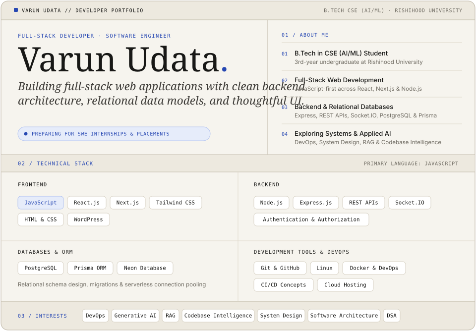
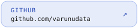
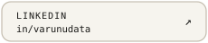
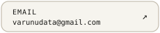
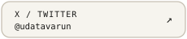

<picture>
  <source media="(prefers-color-scheme: dark)" srcset="./assets/portfolio-dark.svg">
  <source media="(prefers-color-scheme: light)" srcset="./assets/portfolio-light.svg">
  
</picture>

  <a href="https://github.com/varunudata"><picture><source media="(prefers-color-scheme: dark)" srcset="./assets/btn-github-dark.svg"></picture></a>
  <a href="https://www.linkedin.com/in/varunudata"><picture><source media="(prefers-color-scheme: dark)" srcset="./assets/btn-linkedin-dark.svg"></picture></a>
  <a href="mailto:varunudata@gmail.com"><picture><source media="(prefers-color-scheme: dark)" srcset="./assets/btn-email-dark.svg"></picture></a>
  <a href="https://x.com/udatavarun"><picture><source media="(prefers-color-scheme: dark)" srcset="./assets/btn-x-dark.svg"></picture></a>

